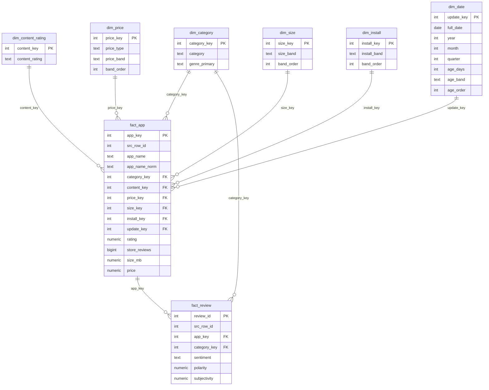

# ERD star schema (schema `dw`)

## Grain

- **fact_app**: mỗi dòng là một ứng dụng sau khi đã khử trùng (`app_name_norm` là duy nhất).
- **fact_review**: mỗi dòng là một review có văn bản, sau khi đã khử trùng và nối được với đúng một ứng dụng (`src_row_id` là duy nhất).

## Sơ đồ

## Ghi chú

- `dim_category` là conformed dimension, dùng chung cho cả hai fact (phục vụ truy vấn drill-across).
- `dim_date` là ngày cập nhật bản của app (Last Updated), không phải ngày của review.
- `store_reviews` (lượt đánh giá trên store) khác với số dòng trong `fact_review`.
- Dòng Unknown (khóa -1) do `03-transform.sql` chèn vào các dimension.
- Chủ đề phàn nàn nằm ở `mart.review_topic`, không nằm trong `dw`.
